<p align="center">
  <a href="./README.md"></a>
  <a href="./README.en.md"></a>
</p>

<h1 align="center">ORBIT PAY</h1>
<p align="center"><strong>Your money, in orbit. Your next break, in Arcade.</strong></p>
<p align="center">Interactive Web3 concept · digital planet · payments · ETH Earn · Snake & Tetris</p>
<p align="center">
  <a href="https://orbit-pay-demo.driver-gourd-0k.workers.dev/">Live demo ↗</a> ·
  <a href="#arcade">Play</a> ·
  <a href="#design">Design</a> ·
  <a href="#run">Run locally</a> ·
  <a href="./README.md">Русский</a>
</p>

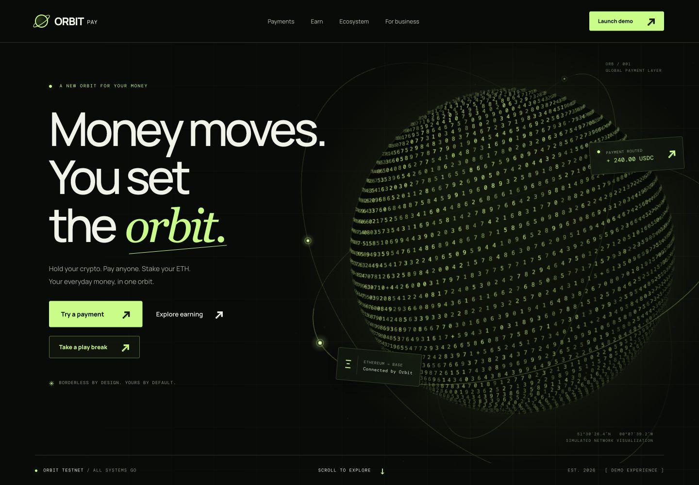

**ORBIT PAY** is a responsive landing page for a fictional crypto finance ecosystem. Holding assets, cross-network payments and staking projections share the idea of a personal orbit. Explore products, send a demo payment, adjust an earning projection, switch integration examples — or take a break with two playable mini-games.

> This is an interface concept. It does not connect a wallet, sign transactions or move funds. Balances, fees, rates, the SDK and **6.8% APY** are illustrative demo data.

<a id="arcade"></a>
## ORBIT ARCADE — take a play break

**Take a play break** in the hero opens Arcade immediately; a second entry is available in the footer. **Snake** and **Tetris** share one native dialog, with custom Canvas graphics, scores, personal bests and on-screen controls in the site's terminal-inspired style.

<table>
  <tr>
    <td width="50%"><a href="docs/images/arcade-snake.jpg">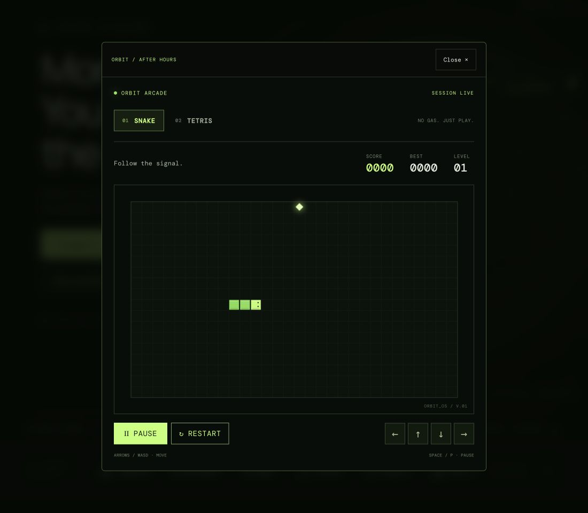</a></td>
    <td width="50%"><a href="docs/images/arcade-tetris.jpg">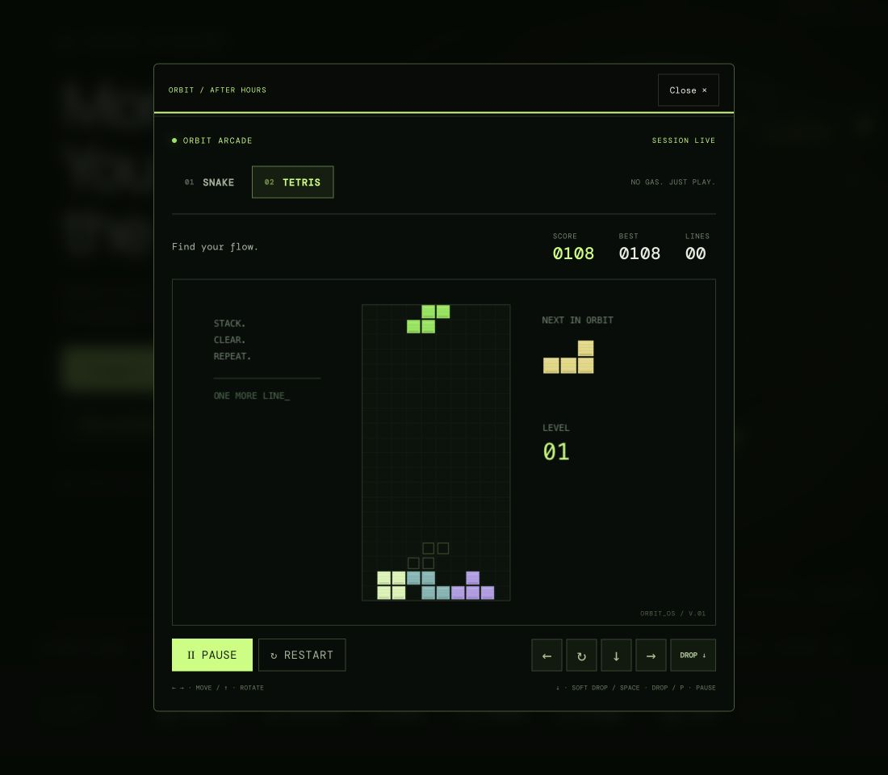</a></td>
  </tr>
  <tr>
    <td><strong>01 / SNAKE</strong><br>Collect energy. Grow your orbit. Keep moving.</td>
    <td><strong>02 / TETRIS</strong><br>Find your flow. Build clean lines. Clear the noise.</td>
  </tr>
</table>

*Screenshots of actual game sessions. Click an image for a closer look.*

### Snake

- A **30 × 18** board, growth after each pickup and **+10 points** per food item.
- Hitting a wall or the snake's body ends the run; filling the entire board wins the game.
- Speed increases with the level: a new level every **50 points**.
- Direct reversal is blocked, and two consecutive turns can be queued.

### Tetris

- All **seven tetrominoes**, using a **seven-bag** generator: each bag contains every piece type.
- Collision-checked rotations, soft drops and hard drops.
- A ghost piece previews the landing position; a side panel shows the next piece.
- Clearing 1–4 lines awards **100 / 300 / 500 / 800 points × level**, with extra points for drops.
- Every **10 cleared lines** advances the level and increases speed.

### Controls

| Action | Snake | Tetris |
| --- | --- | --- |
| Move | Arrow keys or `W A S D` | `←` / `→` or `A` / `D` |
| Rotate | — | `↑` or `W` |
| Soft drop | — | `↓` or `S` |
| Hard drop | — | `Space` during play |
| Pause / resume | `P` or `Space` | `P` |
| Start / resume | **Start / Resume** button | **Start / Resume** button |
| New run | **Restart** button | **Restart** button |
| Touch | On-screen arrows and swipes | On-screen controls, swipes and **Drop** |

Game keys work while focus is inside Arcade. The Snake / Tetris tabs support arrow keys and Home / End. **Close** dismisses the dialog and returns focus to its opener. Escape pauses an active run first; pressing it again closes the dialog.

Personal bests are stored separately for each game in the current browser's `localStorage`, when available. Losing focus, hiding the browser tab, switching games or closing the dialog pauses the run. The game module loads only when Arcade is first opened. There is no game service, sign-up or server-side leaderboard.

<a id="experience"></a>
## Explore the experience

| Section | Interaction |
| --- | --- |
| **Payments** | Amount, USDC / USDT / ETH, network selection, fees and a downloadable demo receipt |
| **Wallet · Pay · Stake** | Orbital nodes switch the route, description and product preview |
| **ETH Earn** | ETH amount, 3 / 6 / 12 months, projected rewards and an interactive chart |
| **Developers** | Synchronized cURL / Webhook / TypeScript examples and clipboard copying |
| **Networks** | A scrolling network strip with a pause control |

### Payment terminal

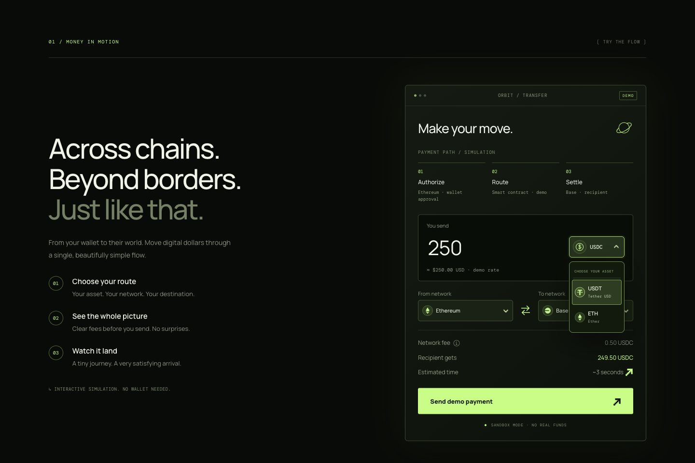

**Authorize → Route → Settle** explains the simulated transfer and displays the current networks. Fees and the recipient amount update before sending. The swap button reverses the route; choosing the same network automatically moves the previous network to the opposite field. Menus match their trigger's width, hide the current selection and support keyboard navigation. Demo networks include Ethereum, Base, Solana and Polygon.

### Three products, one orbit

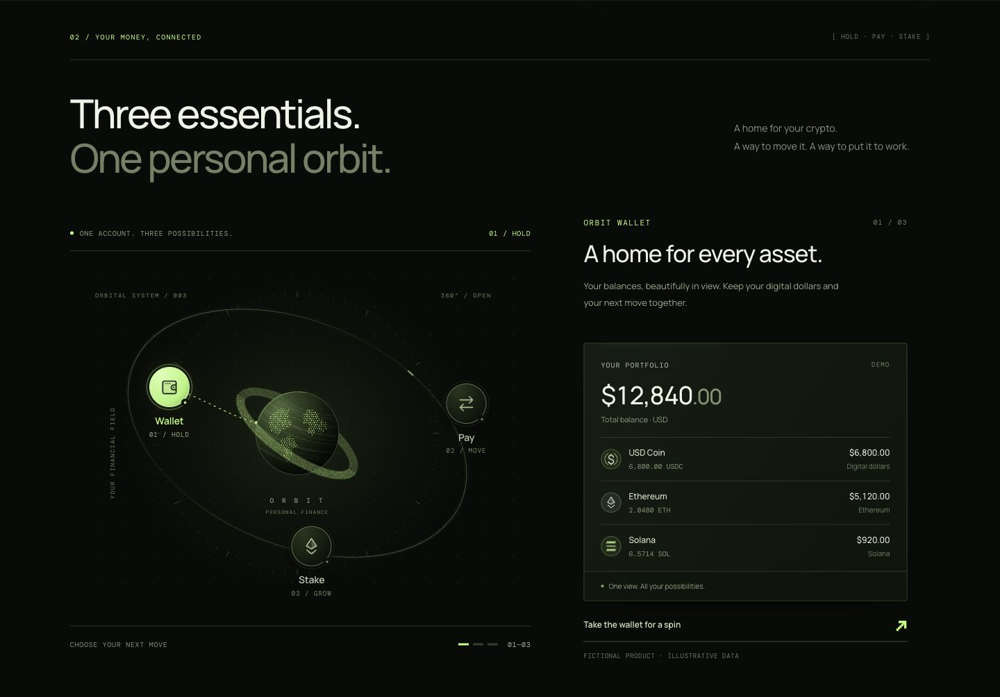

Ten rows of hexadecimal characters surround the SVG sphere. The front and rear ring layers share continuous geometry, with the sphere covering the rear layer. Selecting **Stake** counts the illustrative APY from 0.1 to 6.8% and reveals the reward chart from left to right.

### ETH Earn

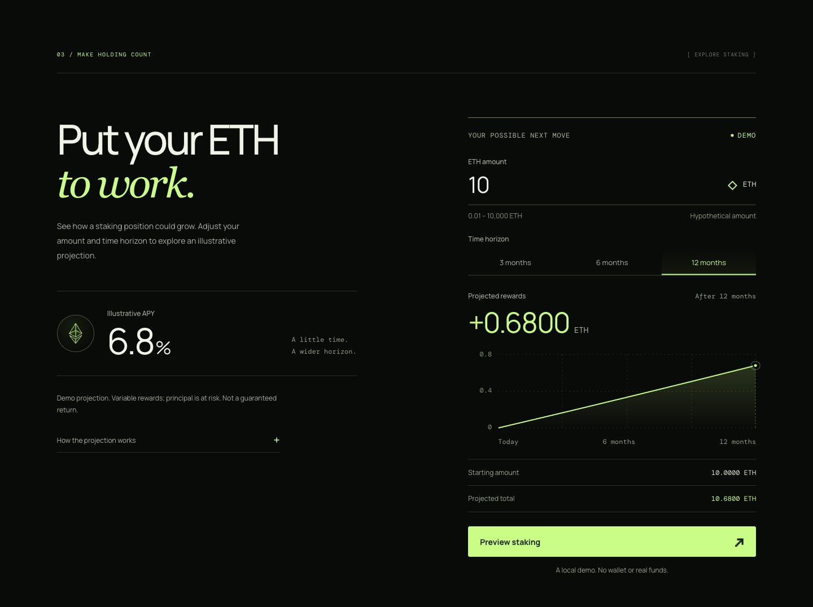

The example accepts **0.01–10,000 ETH** and assumes a constant effective annual APY with reinvestment:

```text
Rewards = ETH amount × (1.068^(months / 12) − 1)
Total = ETH amount + rewards
```

Under these assumptions, **10 ETH over 12 months → 0.68 ETH in rewards → 10.68 ETH total**. Fees, taxes and ETH price changes are not modeled. No real staking position is opened.

### Integration examples

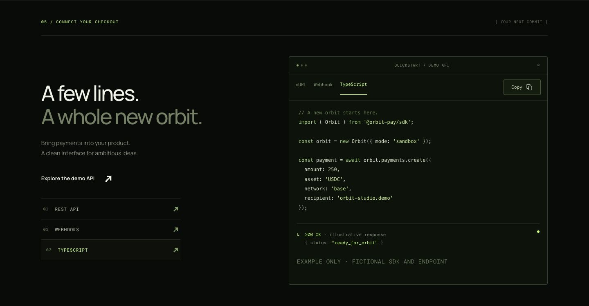

`@orbit-pay/sdk`, `api.orbit-pay.example` and the webhook event are fictional examples and are not executed. The TypeScript tab is an integration sample; the website itself is written in JavaScript.

<a id="design"></a>
## Design: a financial terminal meets orbital mechanics

An almost-black background, lime actions, large typography and fine instrument lines. Section numbers, coordinates, pixel arrows and monospace labels connect the payment flow and the games into one visual system.

| Foundation | Approach |
| --- | --- |
| Palette | Background `#080B08`, panels `#10150F`, lime `#BCFF75`, text `#F0F3E8` |
| Typography | **Manrope** for the interface, **DM Mono** for terminal details, **Georgia italic** for expressive words |
| Hero | Canvas 2D: a numerical sphere, custom perspective, orbits and satellites |
| Ecosystem | SVG: a hexadecimal ring, three dotted land masses and interactive nodes |
| Closing emblem | A larger globe with meridians and latitudes, two rows of characters and one satellite revolution on hover |
| Details | Pixel arrows, animated Copy squares, a rotating plus and short glyph bursts around buttons |

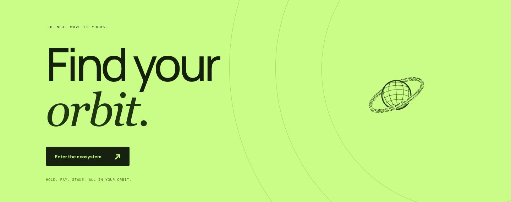

The cursor tail is limited to **114 CSS pixels of travel — roughly 3 cm**. It follows slightly behind the pointer, feathers out at its distant end and disappears completely within **2 seconds** after stopping. Soft masks protect text, controls, colored panels and the ecosystem composition. Glyphs turn dark on the lime section.

`prefers-reduced-motion` disables decorative motion and displays charts in their final state. Games retain explicit start controls. Touch pointers do not generate a trail. Grid, Flexbox, `clamp()`, media queries and container queries adapt the layout.

<details>
<summary><strong>More screenshots: Stake, networks, cursor tail and mobile layout</strong></summary>

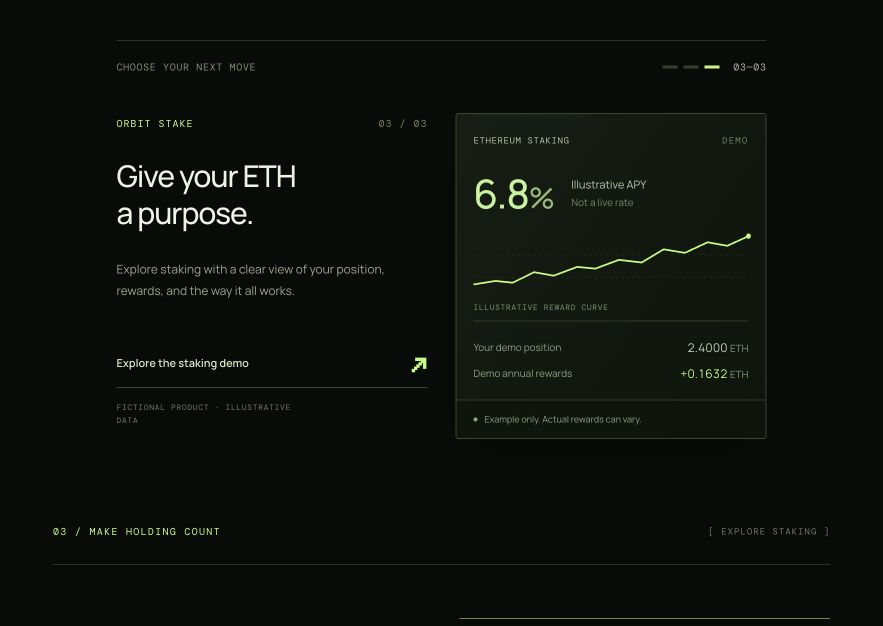
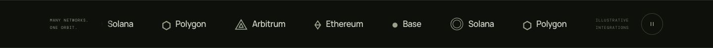
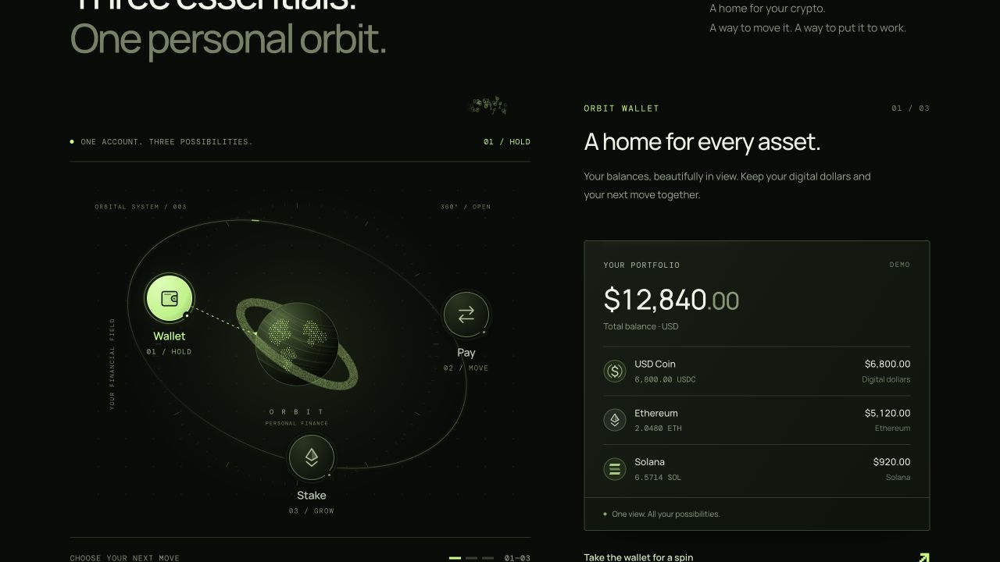
<p align="center">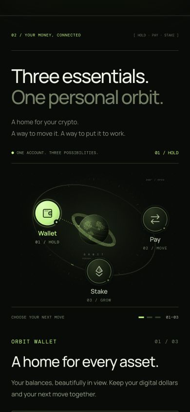</p>

</details>

## Technology and architecture

| Layer | Technology |
| --- | --- |
| Interface | HTML5, CSS3, JavaScript ES modules; no client framework or UI library |
| Graphics | Canvas 2D, SVG, Path2D, gradients, masks and glyph atlases; no WebGL |
| Games | Custom Snake and Tetris engines, `requestAnimationFrame`, keyboard and Pointer Events |
| State | DOM, native `dialog`, Clipboard API and `localStorage` for personal bests |
| Performance | IntersectionObserver, ResizeObserver, MutationObserver and Page Visibility API |
| Fonts | Google Fonts: Manrope and DM Mono, with system fallbacks |
| Local server | Node.js: `node:http`, `node:fs/promises`, `node:path`, `node:url` |
| Tests | Node.js and `node:assert/strict`; four test suites |
| Hosting | Ready-to-serve `dist/` assets; the current public demo is hosted on Cloudflare |

Obstacle masks are cached and blurred only when recomputed. Each frame updates the area occupied by the tail. The planet shares vector contours without `getImageData`. Hidden scenes stop rendering, and the games and cursor tail do not keep an unnecessary render loop running after their work is finished.

```text
orbit-pay-demo/
├── README.md                 # Russian — default documentation
├── README.en.md              # English
├── dist/                     # Ready-to-serve site and source
│   ├── index.html / main.js   # Landing page and interactions
│   ├── arcade.js / arcade.css # Snake, Tetris and their interface
│   ├── planet.js             # Numerical sphere
│   ├── cursor-trail.js        # Short tail and soft masks
│   ├── ecosystem.js / .css    # Wallet · Pay · Stake
│   ├── earn.js / .css         # Projection and chart
│   └── …                     # Styles, menus, logos and icons
├── docs/assets/              # Language buttons
├── docs/images/              # Website and game screenshots
├── tests/                    # Payment · Earn · Arcade · Motion
└── serve.mjs                 # Local HTTP server
```

<a id="run"></a>
## Run locally

Requires **Node.js 20+**. There are no npm packages to install.

```sh
git clone https://github.com/bugubuleb/orbit-pay-demo.git
cd orbit-pay-demo
npm run dev
```

Open **http://127.0.0.1:4173**. Select **Take a play break → Snake / Tetris → Start game** to play. `npm start` runs the same server; use `PORT=4174 npm run dev` for a different port.

Use an HTTP server because the application relies on ES modules. Public deployments should use HTTPS, including for the Clipboard API and `crypto.randomUUID()`.

## Tests

```sh
npm test
```

| Suite | Coverage |
| --- | --- |
| **Payment** | Input, precision, fees, 288 calculation combinations, identical-network swapping and sphere projection |
| **Earn** | Effective APY, reinvestment, input bounds and chart data |
| **Arcade** | 14 scenarios: Snake movement, pause, growth and collisions; Tetris seven-bag, rotations, drops, lines, speed and game over |
| **Motion** | Mask caching, geometry updates, tail length, two-second expiry, pointer modes and listener cleanup |

These are Node.js logic tests. Screenshots and interface interactions are verified separately in the browser.

## Deployment

Publish **the contents of `dist/`** to a static host with HTTPS. No build step is required; `index.html` is the entry point. Relative asset paths support both a domain root and a subdirectory. `serve.mjs` is for local previews and listens only on `127.0.0.1`.

The README files, tests and `docs/` assets are not required to run the site. This demo does not require secret keys, a database or a payment server.

## Made with

**Codex** handled development, interface iterations and verification. **GPT-6 Astra / ultra subagents** contributed to graphics, games and independent reviews. **GitHub** hosts the source, **Sites** hosted the original demo, and **Cloudflare** hosts the current public version.

<p align="center"><strong>HOLD. PAY. STAKE. TAKE A PLAY BREAK.</strong><br><a href="https://orbit-pay-demo.driver-gourd-0k.workers.dev/">Explore ORBIT PAY ↗</a> · <a href="./README.md">Читать на русском</a></p>
