<p align="center">
  <a href="./README.md"></a>
  <a href="./README.en.md"></a>
</p>

<h1 align="center">ORBIT PAY</h1>
<p align="center"><strong>Деньги на своей орбите. Небольшая пауза — в Arcade.</strong></p>
<p align="center">Интерактивный Web3-концепт · цифровая планета · платежи · ETH Earn · Snake & Tetris</p>
<p align="center">
  <a href="https://orbit-pay-demo.driver-gourd-0k.workers.dev/">Открыть демо ↗</a> ·
  <a href="#arcade">Игры</a> ·
  <a href="#design">Дизайн</a> ·
  <a href="#run">Запустить локально</a> ·
  <a href="./README.en.md">English</a>
</p>

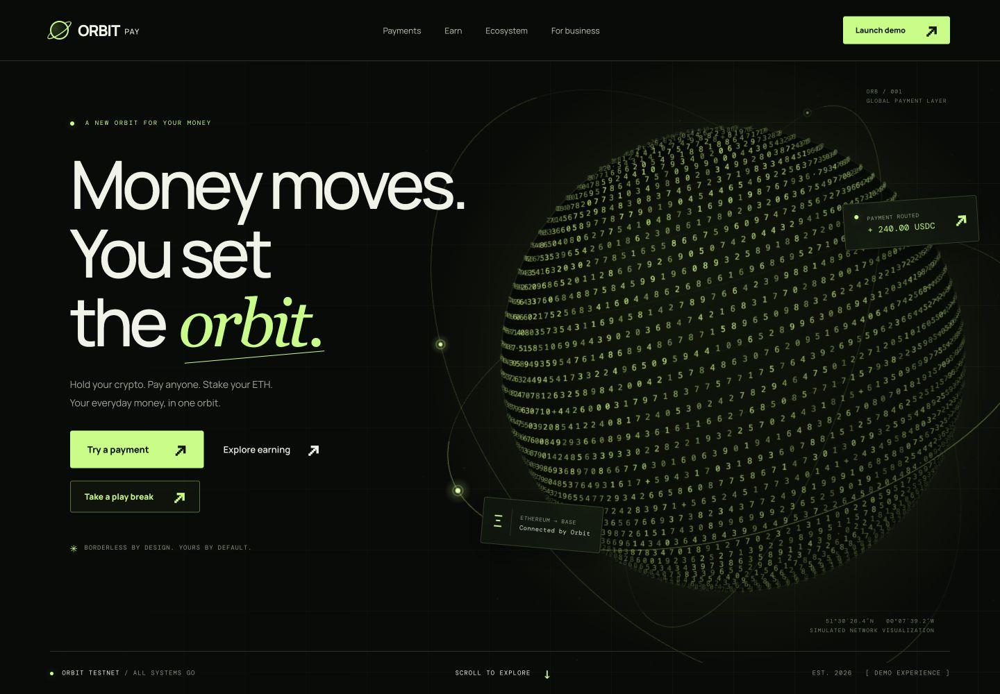

**ORBIT PAY** — адаптивный лендинг вымышленной криптофинансовой экосистемы. Хранение активов, переводы между сетями и прогноз стейкинга собраны вокруг идеи личной орбиты. Сайт можно исследовать: выбрать продукт, провести демо-платёж, изменить прогноз доходности, переключить примеры интеграции — и сыграть в две полноценные мини-игры.

> Это концепт интерфейса. Сайт не подключает кошелёк, не подписывает транзакции и не переводит средства. Балансы, комиссии, курсы, SDK и **6,8% APY** — демонстрационные данные.

<a id="arcade"></a>
## ORBIT ARCADE — take a play break

Кнопка **Take a play break** на первом экране сразу открывает Arcade. В футере есть второй вход. Внутри одного диалогового окна доступны **Snake** и **Tetris**: собственная Canvas-графика, счёт, рекорды и экранные кнопки в том же терминальном стиле, что и весь сайт.

<table>
  <tr>
    <td width="50%"><a href="docs/images/arcade-snake.jpg">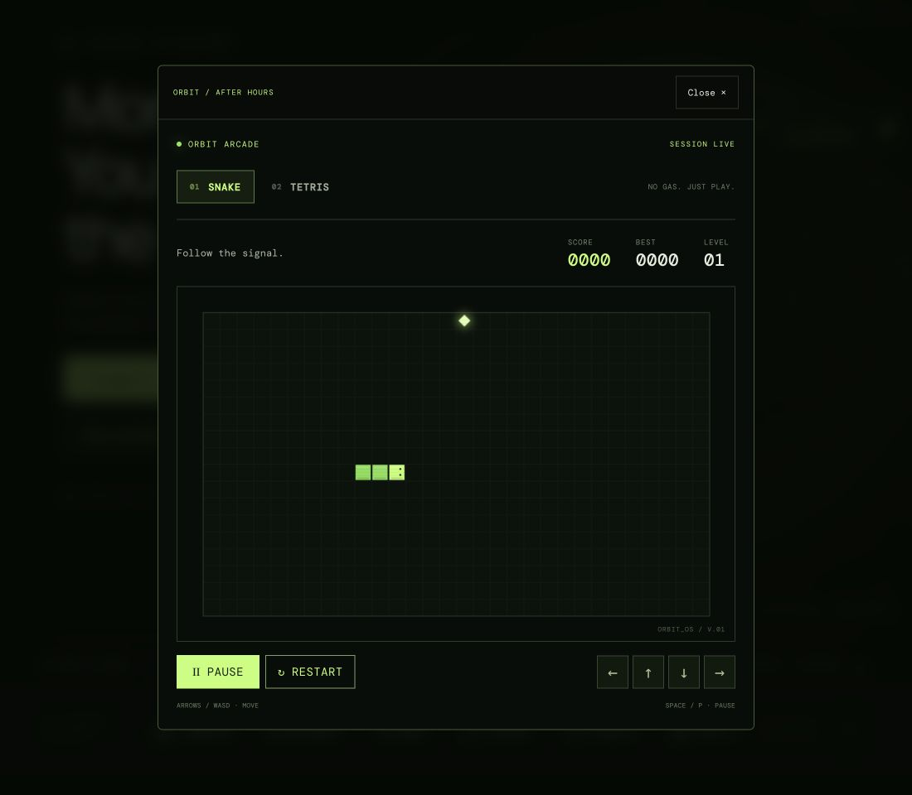</a></td>
    <td width="50%"><a href="docs/images/arcade-tetris.jpg">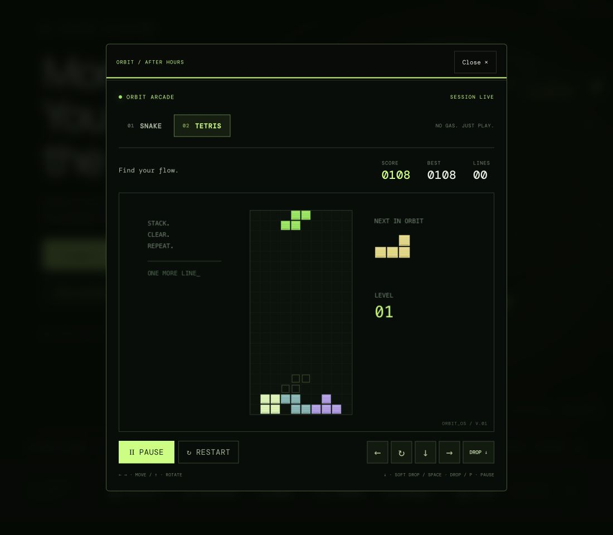</a></td>
  </tr>
  <tr>
    <td><strong>01 / SNAKE</strong><br>Собирай энергию. Расти. Не замыкай орбиту.</td>
    <td><strong>02 / TETRIS</strong><br>Находи ритм. Собирай линии. Освобождай пространство.</td>
  </tr>
</table>

*Скриншоты настоящих игровых сессий. Нажмите на изображение, чтобы рассмотреть интерфейс.*

### Snake

- Поле **30 × 18 клеток**, рост после каждого собранного элемента и **+10 очков** за еду.
- Столкновение со стеной или своим телом завершает партию; заполнение всего поля означает победу.
- Скорость растёт вместе с уровнем: новый уровень каждые **50 очков**.
- Разворот прямо в собственное тело заблокирован, два последовательных поворота можно ввести заранее.

### Tetris

- Все **семь тетромино** и генератор **seven-bag**: каждая семёрка содержит все типы фигур.
- Повороты с проверкой свободного места, мягкое и мгновенное падение.
- Полупрозрачная проекция показывает место приземления; рядом видна следующая фигура.
- Очистка 1–4 линий даёт **100 / 300 / 500 / 800 очков × уровень**. Падения приносят дополнительные очки.
- Каждые **10 очищенных линий** повышают уровень и скорость.

### Управление

| Действие | Snake | Tetris |
| --- | --- | --- |
| Движение | Стрелки или `W A S D` | `←` / `→` или `A` / `D` |
| Поворот фигуры | — | `↑` или `W` |
| Мягкое падение | — | `↓` или `S` |
| Мгновенное падение | — | `Space` во время игры |
| Пауза / продолжение | `P` или `Space` | `P` |
| Начать / продолжить | Кнопка **Start / Resume** | Кнопка **Start / Resume** |
| Новая партия | Кнопка **Restart** | Кнопка **Restart** |
| Сенсорное управление | Экранные стрелки и свайпы | Экранные кнопки, свайпы, **Drop** |

Клавиши игры работают, когда фокус находится внутри Arcade. Вкладки Snake / Tetris поддерживают стрелки и Home / End. Кнопка **Close** закрывает окно и возвращает фокус к исходной кнопке. Escape сначала ставит активную партию на паузу; повторное нажатие закрывает окно.

Рекорды сохраняются отдельно для каждой игры в `localStorage` текущего браузера, если хранилище доступно. Потеря фокуса, скрытие вкладки, переключение игры и закрытие окна ставят партию на паузу. Игровой модуль загружается только при первом открытии Arcade; запросов к игровой службе, регистрации и серверной таблицы лидеров нет.

<a id="experience"></a>
## Что ещё можно попробовать

| Раздел | Взаимодействие |
| --- | --- |
| **Payments** | Сумма, USDC / USDT / ETH, выбор сетей, комиссия и скачиваемая демо-квитанция |
| **Wallet · Pay · Stake** | Орбитальные узлы переключают описание, маршрут и продуктовую карточку |
| **ETH Earn** | Сумма ETH, срок 3 / 6 / 12 месяцев, награды и интерактивный график |
| **Developers** | Синхронные переключатели cURL / Webhook / TypeScript и копирование примера |
| **Networks** | Бегущая строка сетей с возможностью остановить движение |

### Платёжный терминал

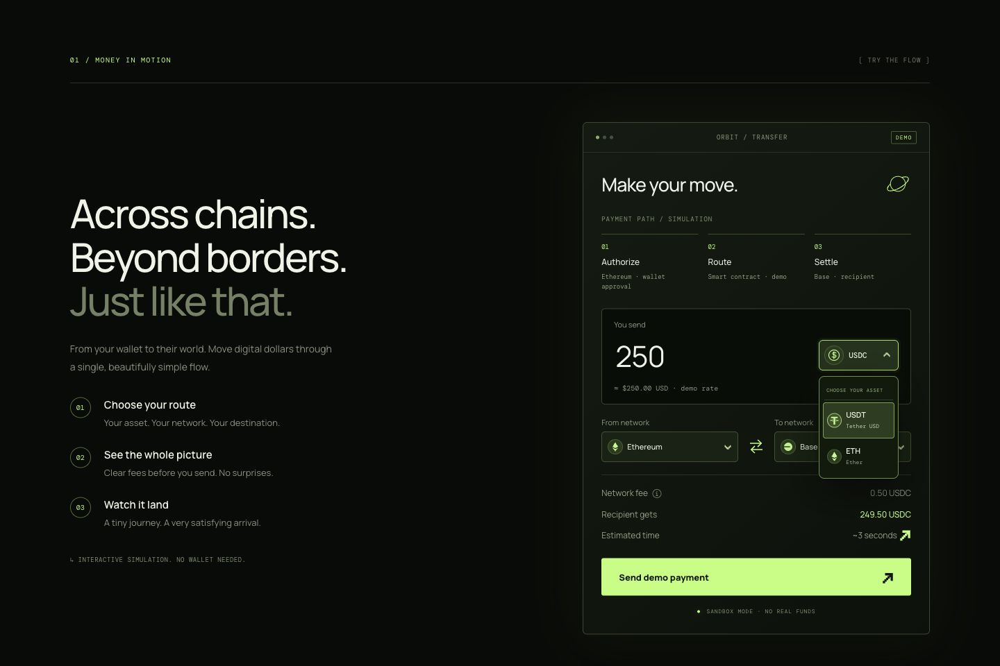

Маршрут **Authorize → Route → Settle** показывает процесс демо-перевода и текущие сети. Комиссия и сумма получателю пересчитываются до отправки. Кнопка между сетями меняет направление; при выборе одинаковой сети вторая автоматически заменяется прежней сетью первого поля. Меню имеют ширину своего поля, скрывают выбранный вариант и поддерживают клавиатуру. Сети примера: Ethereum, Base, Solana и Polygon.

### Три продукта на одной орбите

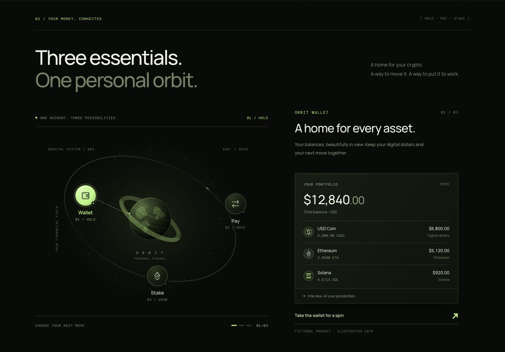

SVG-сфера окружена десятью рядами шестнадцатеричных символов. Передняя и задняя части кольца соединены общей геометрией; сфера перекрывает заднюю часть. При выборе **Stake** число APY растёт от 0,1 до 6,8%, а график раскрывается слева направо.

### ETH Earn

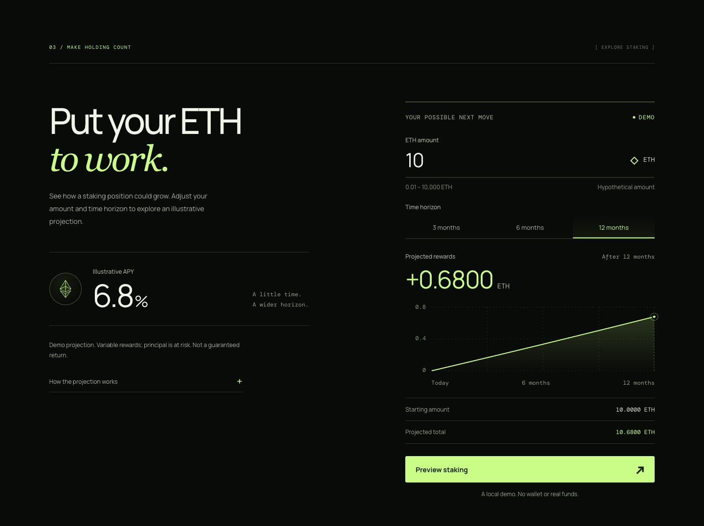

Пример принимает **0,01–10 000 ETH** и использует постоянный эффективный годовой APY с реинвестированием:

```text
Награда = сумма ETH × (1.068^(месяцы / 12) − 1)
Итог = сумма ETH + награда
```

При этих допущениях **10 ETH за 12 месяцев → 0,68 ETH наград → 10,68 ETH итого**. Комиссии, налоги и изменение цены ETH не моделируются; реальная позиция не открывается.

### Интеграции

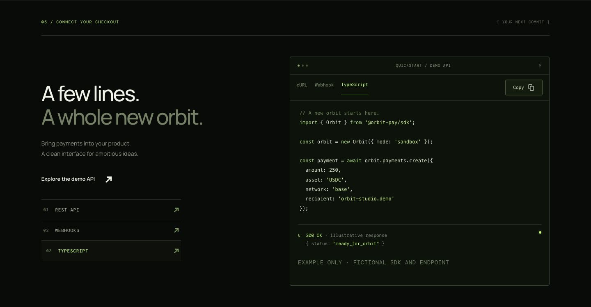

Примеры `@orbit-pay/sdk`, `api.orbit-pay.example` и webhook-события иллюстративные и не выполняются. Вкладка TypeScript — пример интеграции; сам сайт написан на JavaScript.

<a id="design"></a>
## Дизайн: финансовый терминал встречает орбитальную механику

Почти чёрный фон, лаймовые действия, крупная типографика и тонкие приборные линии. Нумерация секций, координаты, пиксельные стрелки и моноширинные подписи связывают платёжную форму и игровой интерфейс в одну систему.

| Основа | Решение |
| --- | --- |
| Палитра | Фон `#080B08`, панели `#10150F`, лайм `#BCFF75`, текст `#F0F3E8` |
| Типографика | **Manrope** для интерфейса, **DM Mono** для терминала, **Georgia italic** для акцентных слов |
| Первый экран | Canvas 2D: цифровая сфера, собственная перспектива, орбиты и спутники |
| Экосистема | SVG: кольцо из символов, три точечных материка, интерактивные узлы |
| Финальная эмблема | Увеличенная сфера с меридианами и широтами, два ряда символов и один оборот спутника при наведении |
| Детали | Пиксельные стрелки, анимация Copy, вращение плюса, короткий разлёт символов у кнопок |

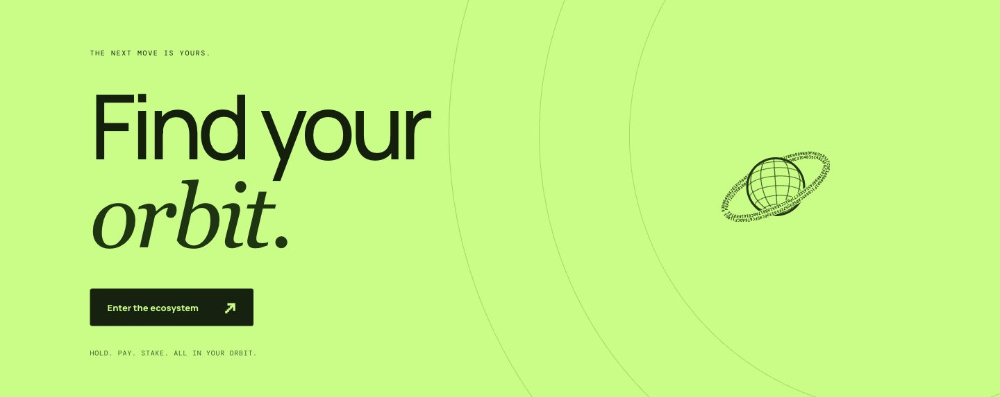

Шлейф указателя ограничен **114 CSS-пикселями пути — примерно 3 см**. Он следует немного позади мыши, плавно исчезает с дальнего конца и полностью гаснет максимум за **2 секунды** после остановки. Текст, поля, цветные панели и композиция экосистемы защищены мягкими масками; на лаймовом фоне символы тёмные.

Поддерживается `prefers-reduced-motion`: декоративные движения отключаются, графики сразу показывают итоговое состояние. Игры сохраняют управление и явный запуск. Сенсорный указатель не включает след. Размеры интерфейса адаптируются через Grid, Flexbox, `clamp()`, media queries и container queries.

<details>
<summary><strong>Ещё скриншоты: Stake, сети, шлейф и мобильная версия</strong></summary>

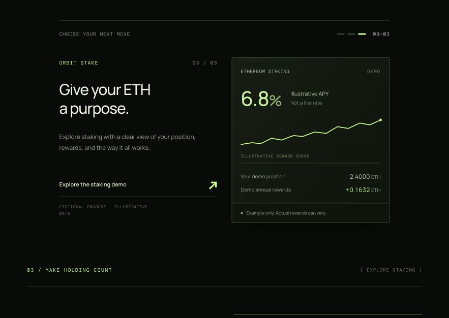
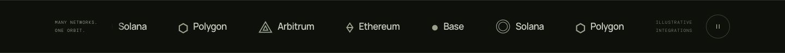
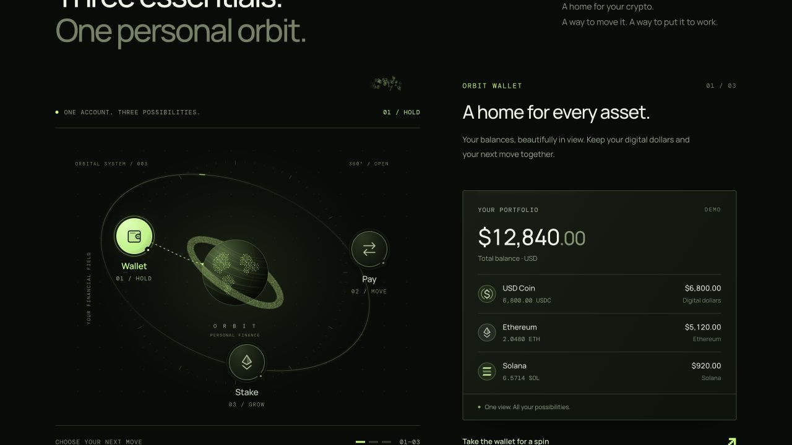
<p align="center">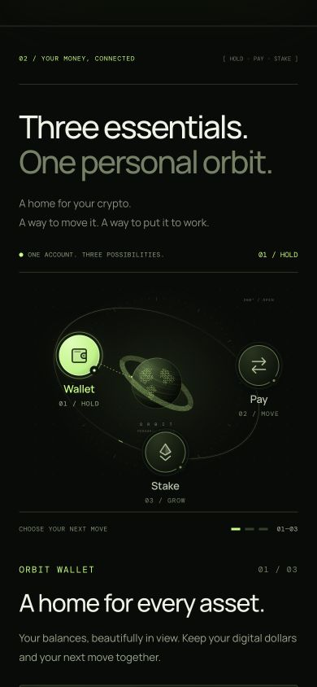</p>

</details>

## Технологии и устройство проекта

| Слой | Технологии |
| --- | --- |
| Интерфейс | HTML5, CSS3, JavaScript ES modules; без клиентского фреймворка и UI-библиотеки |
| Графика | Canvas 2D, SVG, Path2D, градиенты, маски и атласы символов; без WebGL |
| Игры | Собственные движки Snake и Tetris, `requestAnimationFrame`, клавиатура и Pointer Events |
| Состояния | DOM, нативный `dialog`, Clipboard API, `localStorage` для рекордов |
| Производительность | IntersectionObserver, ResizeObserver, MutationObserver и Page Visibility API |
| Шрифты | Google Fonts: Manrope и DM Mono; системные резервные шрифты |
| Локальный сервер | Node.js: `node:http`, `node:fs/promises`, `node:path`, `node:url` |
| Проверки | Node.js и `node:assert/strict`; четыре набора тестов |
| Публикация | Готовые файлы `dist/`; текущее публичное демо размещено в Cloudflare |

Маски препятствий кэшируются, размытие выполняется при их пересчёте, а на каждом кадре обновляется только область следа. Планета передаёт векторные контуры без `getImageData`. Скрытые сцены останавливаются; игры и шлейф не поддерживают лишний цикл отрисовки после завершения работы.

```text
orbit-pay-demo/
├── README.md                 # Русский — основная документация
├── README.en.md              # English
├── dist/                     # Готовый статический сайт и исходники
│   ├── index.html / main.js   # Лендинг и сценарии
│   ├── arcade.js / arcade.css # Snake, Tetris и их интерфейс
│   ├── planet.js             # Цифровая сфера
│   ├── cursor-trail.js        # Короткий хвост и мягкие маски
│   ├── ecosystem.js / .css    # Wallet · Pay · Stake
│   ├── earn.js / .css         # Прогноз и график
│   └── …                     # Стили, меню, логотипы и иконки
├── docs/assets/              # Кнопки выбора языка
├── docs/images/              # Скриншоты сайта и игр
├── tests/                    # Payment · Earn · Arcade · Motion
└── serve.mjs                 # Локальный HTTP-сервер
```

<a id="run"></a>
## Запустить локально

Нужен **Node.js 20+**. Устанавливать npm-пакеты не требуется.

```sh
git clone https://github.com/bugubuleb/orbit-pay-demo.git
cd orbit-pay-demo
npm run dev
```

Откройте **http://127.0.0.1:4173**. Нажмите **Take a play break → Snake / Tetris → Start game**, чтобы играть. `npm start` запускает тот же сервер; для другого порта: `PORT=4174 npm run dev`.

Запускайте через HTTP-сервер: приложение использует ES modules. Для публичного демо используйте HTTPS, в том числе для Clipboard API и `crypto.randomUUID()`.

## Проверки

```sh
npm test
```

| Набор | Что проверяется |
| --- | --- |
| **Payment** | Ввод, точность, комиссии, 288 комбинаций расчёта, смена одинаковых сетей и проекция сферы |
| **Earn** | Эффективный APY, реинвестирование, границы ввода и данные графика |
| **Arcade** | 14 сценариев: движение, пауза, рост и столкновения Snake; seven-bag, повороты, падения, линии, скорость и завершение Tetris |
| **Motion** | Кэширование масок, обновление геометрии, длина хвоста, затухание за 2 секунды, режимы указателя и очистка обработчиков |

Это проверки логики в Node.js. Скриншоты и взаимодействия интерфейса проверяются отдельно в браузере.

## Размещение

Публикуйте **содержимое `dist/`** на статическом хостинге с HTTPS. Сборка не нужна; точка входа — `index.html`. Относительные пути подходят для корня домена и подкаталога. `serve.mjs` нужен для локального просмотра и слушает только `127.0.0.1`.

README, тесты и `docs/` не нужны для работы сайта. Секретные ключи, база данных и платёжный сервер для этого демо не требуются.

## Как создавался проект

**Codex** — разработка, итерации интерфейса и проверка. **Субагенты GPT-6 Astra / ultra** участвовали в задачах графики, игр и независимой проверки. **GitHub** хранит исходники, **Sites** использовался для первоначального демо, **Cloudflare** — для текущей публичной версии.

<p align="center"><strong>HOLD. PAY. STAKE. TAKE A PLAY BREAK.</strong><br><a href="https://orbit-pay-demo.driver-gourd-0k.workers.dev/">Исследовать ORBIT PAY ↗</a> · <a href="./README.en.md">Read in English</a></p>
